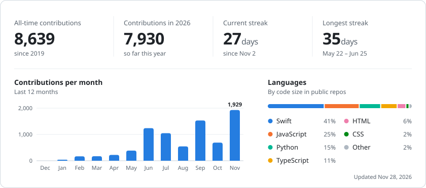

<picture>
  <source media="(prefers-color-scheme: dark)" srcset="assets/header-dark.svg">
  
</picture>

<p align="center">
  <a href="https://www.linkedin.com/in/turki-faisal-7bb768231/"></a>
  <a href="mailto:turkifaisal.dev@gmail.com"></a>
  <a href="https://app.daily.dev/lltrx"></a>
</p>

Hey! I'm Turki 👋, an app developer based in Riyadh. I've worked on all kinds of projects across mobile and the web, and lately the Mac too. I really enjoy making apps people find useful, and when I'm not coding you'll probably catch me geeking out over the latest frameworks or whatever new technology just dropped.

- 💳 **Part of** AjelPay, a payments platform for invoices, payment links, subscriptions and instalments
- 🤝 **Part of** GCDC, the Google Developer Community in Saudi Arabia, where I developed [the community portal](https://saudigcdc.com/en): events, registration, certificates and the blog
- 🛠️ **Built** Soghari and Markly, and [Shelf](https://github.com/lltrx/shelf-clipboard), a clipboard manager for macOS that never leaves your Mac
- ☁️ **Next up:** cloud architecture
- 🏠 **Into** homelabs, running and self-hosting my own services at home
- 💬 **Open to** freelance projects and technical discussions

## Featured project

<h3>
  
  <a href="https://github.com/lltrx/shelf-clipboard">Shelf</a>: clipboard history that stays on your Mac
</h3>

<p>
  <a href="https://github.com/lltrx/shelf-clipboard/releases/latest"></a>
  
  
  
</p>

A small, native clipboard manager written in Swift and SwiftUI with no dependencies. Everything you copy stays on your Mac: no iCloud, no account, no network code.

Press **⇧⌘V** anywhere to see everything you've copied, then paste it formatted, as plain text, as Markdown or as clean JSON. Mark up screenshots, grab the text from anything on screen, and keep pinboards of snippets. Keys and passwords are masked and deleted after a few minutes.

<a href="https://github.com/lltrx/shelf-clipboard"></a>

```sh
brew trust lltrx/tap
brew install --cask lltrx/tap/shelf-clipboard
```

Signed and notarized by Apple · [See it in action](https://github.com/lltrx/shelf-clipboard#readme) · [User guide](https://github.com/lltrx/shelf-clipboard/blob/main/docs/USER_GUIDE.md) · [Releases](https://github.com/lltrx/shelf-clipboard/releases)

## Tech stack

**Mobile & Mac** · Swift, SwiftUI, Flutter, React Native, Expo<br>


**Web** · TypeScript, JavaScript, React, Angular, Tailwind CSS<br>


**Backend** · Node.js, Express, .NET, Django, Spring Boot, Python<br>


**Data, cloud & tools** · MongoDB, Firebase, Google Cloud, Git, VS Code, Xcode, Figma<br>


## GitHub activity

<picture>
  <source media="(prefers-color-scheme: dark)" srcset="assets/stats-dark.svg">
  
</picture>

<sub>Drawn from the GitHub API and refreshed every day by a <a href=".github/workflows/profile-cards.yml">workflow in this repo</a>.</sub>
